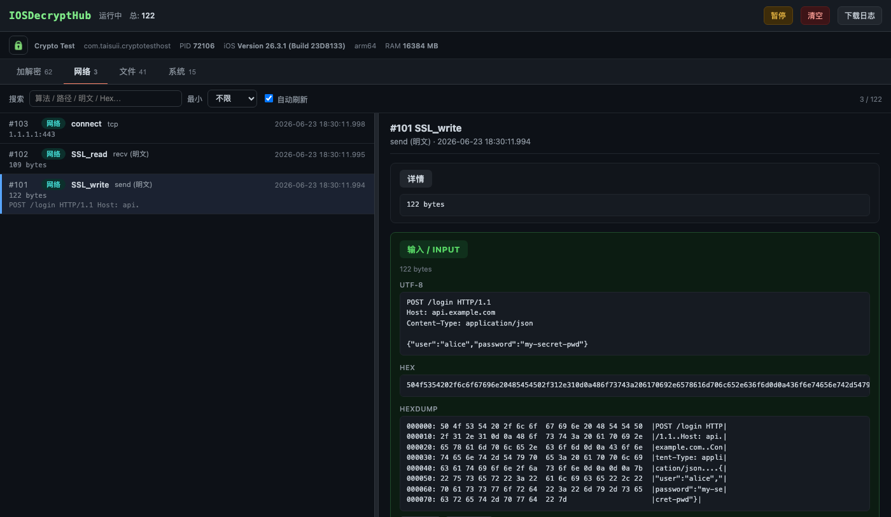
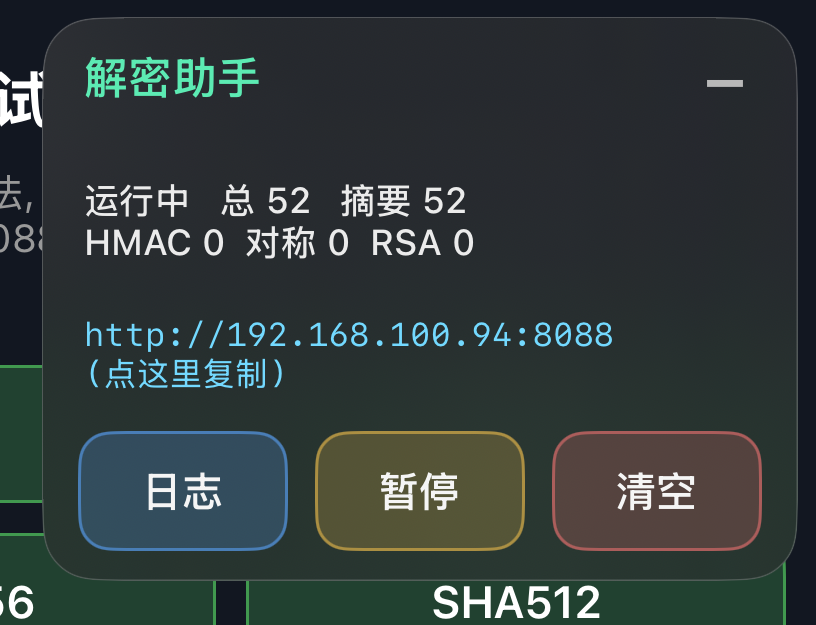
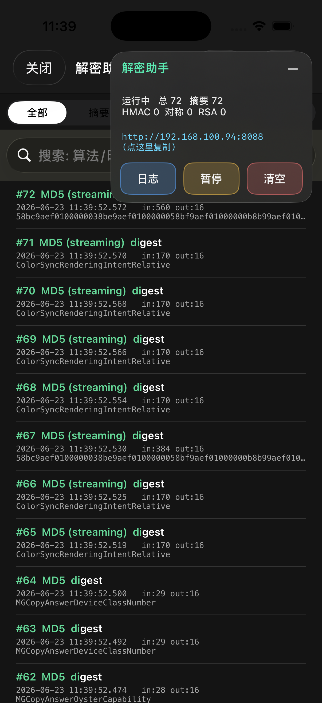

# IOSDecryptHub

基于 fishhook 的 iOS App 行为监控平台。已实现四类监控：**加解密审计**（哈希 / HMAC / 对称 / 非对称 / KDF 的算法、Key、IV、明文、密文）、**网络抓包**（connect 目标 + SSL_write/SSL_read 的 TLS 明文请求与响应）、**文件监控**（open / write / unlink / rename 沙盒文件操作）、**系统模块**（dlopen 载入的动态库），每次调用都附应用层调用栈。Web 面板多 tab 架构，浏览器即可实时查看。

注入到目标 App 后，它自己调用系统加密 API 时，你能在旁边实时看到全部参数。

## 截图

Web 面板（多 tab + 宿主 App 图标 + 左右分栏 master-detail）、交互式测试台、iOS 悬浮窗与全屏日志查看器。

| Web 面板（加解密 tab，左右分栏） | 多 tab 平台（占位：网络 / 文件 / 内存 / 系统 / 调用链） |
| --- | --- |
|  |  |
| 交互式测试台 | 悬浮窗（毛玻璃，可拖动、可收起成胶囊） |
|  |  |
| 全屏日志查看器（分类切换、搜索、详情展开） | |
|  | |

## 覆盖的算法

拦截的是 CommonCrypto 与 Security.framework 这两套系统库，macOS 与 iOS 上同名同接口。

- 摘要（Digest）：MD2 / MD4 / MD5、SHA1 / SHA224 / SHA256 / SHA384 / SHA512，一次性与流式 Init/Update/Final 都覆盖，流式会把分片喂入的数据拼回完整明文。
- HMAC：CCHmac 系列，解析为 HMAC-SHA256 等。
- 对称加密：AES / DES / 3DES / RC4 / RC2 / CAST / Blowfish，覆盖 CCCrypt（一次性）、CCCryptorCreate / CCCryptorCreateWithMode / CCCryptorUpdate / CCCryptorFinal（流式），自动识别 ECB / CBC / CTR / CFB / OFB 模式与 PKCS7 填充。
- 非对称：RSA / EC 的签名、验签、加密、解密（SecKey 系列）。
- 密钥派生（KDF）：CCKeyDerivationPBKDF（PBKDF2），记录明文口令、salt、迭代次数、PRF 与派生出的密钥。

## 三种查看方式

1. 本地 Web 服务（推荐）。dylib 加载后自动在 8088 起一个零依赖的 HTTP 服务，浏览器访问即可。多 tab 架构，加解密 tab 为左右分栏 master-detail（左列表 / 右详情，分隔条可拖动，输入/输出上下卡片）。支持实时列表、分类切换、关键字搜索、按数据大小过滤、详情展开（Key/IV/明文/密文的 Hex 与 HexDump、调用栈）、暂停、清空、下载日志文件。顶部展示宿主 App 图标与进程信息（应用名、bundle id、PID、系统版本、设备型号、物理内存）。
2. iOS 内嵌悬浮窗 + 全屏查看器。悬浮窗是一个毛玻璃质感的小窗，显示各分类计数与服务地址，可拖动、可缩小成胶囊；点其中的日志按钮弹出全屏查看器看完整明细。
3. 文件落盘。所有日志同时异步追加到 Documents/decrypt_helper.log，可用于导出。

安全提示：Web 服务无认证、监听所有网卡（0.0.0.0），会把 Key 与明文暴露给同网络中任何能连接的人，仅建议在可信网络中调试使用。

## 监控能力

Web 面板多 tab 架构，四类监控共享同一套左右分栏 master-detail（左列表 + 右详情，详情按类型自适应字段）：

| tab | hook 目标 | 能看到什么 |
| --- | --- | --- |
| 加解密 | CommonCrypto / SecKey | 算法 / Key / IV / 明文 / 密文 / 调用栈 |
| 网络 | connect / SSL_write / SSL_read | 目标 IP:port / TLS 明文请求与响应 |
| 文件 | open / write / unlink / rename | 沙盒文件读写、删除、重命名（过滤系统噪音） |
| 系统 | dlopen | 运行时载入的动态库 |

> 注：网络的 SSL_write/SSL_read 抓的是 App 自带 BoringSSL/OpenSSL 的明文（系统 Network.framework 的 TLS 不走这两个符号）；内存（malloc/free）因高频且记录路径自身会触发 malloc 易递归，暂不纳入。

## 性能与实现要点

- 日志写入走独立串行队列异步落盘，不阻塞被 hook 的调用方（宿主 App）。
- 分类计数为 O(1) 缓存读取，悬浮窗每秒刷新无遍历开销。
- 内存中按环形缓冲保留最近若干条；单段 blob 落盘有上限（默认 64KB），避免大数据撑爆内存。
- HTTP 服务用信号量限制并发连接、设读超时、fd 耗尽时指数退避，并支持日志文件分块下载。

## 健康监控（fail-loud）

hook 框架最怕「时好时坏」：某个符号没挂上、服务端口被占、日志落盘失败却被静默兜底，让你以为一切正常，真正的失效点被掩盖、难以定位。本插件坚持 fail-loud——失效就让它可见：

- 每个 hook 模块安装后立即自检，没挂上的符号会被记录（MD2/MD4 等系统已移除的废弃算法除外，避免常态化误报淹没真正的告警）。
- HTTP 服务起不来、日志落盘失败、流式加密遇到未跟踪的上下文，都会上报。
- 失效状态三处同时可见：悬浮窗顶部红字、Web 面板红色横幅、控制台 `[IOSDecryptHub/ERR]` 日志，一眼定位失效锚点，但不中止宿主 App。
- `GET /api/stats` 的 `health` 字段暴露 hook 失败数与落盘/服务状态，便于自动化巡检。

## HTTP API

| 端点 | 说明 |
| --- | --- |
| GET / | 嵌入式单页前端 |
| GET /api/stats | total / paused / byCategory / port / version / process（进程信息）/ health（健康状态） |
| GET /api/logs?cat=N&q=KW&minSize=N&since=SEQ&limit=N | 日志摘要数组，minSize 按字节数过滤 |
| GET /api/logs/:seq | 单条详情（含 Hex / HexDump / 调用栈） |
| POST /api/clear | 清空内存与文件 |
| POST /api/pause?paused=1 | 暂停 / 恢复 |
| GET /download | 下载日志文件 |

## 编译

```
make            # iOS 真机 (arm64, iPhoneOS SDK)
make mac        # macOS 原生 (用于 Mac 灰度自测)
make linux      # Linux 交叉编译 (需 IOS_SDK 与 CROSS_CC 环境变量)
```

产物为 decrypt_helper.dylib。

## 注入到 IPA

```
./scripts/inject.sh <input.ipa> decrypt_helper.dylib
```

脚本用 insert_dylib 写入 LC_LOAD_DYLIB，产出 hooked_<input>.ipa，用 AltStore / Sideloadly 重签后安装到非越狱设备；越狱设备可直接安装。

## 测试

仓库自带一个交互式测试宿主 App（sim_uitest/），按分类提供按钮，点哪个按钮就触发对应算法，便于逐个观察 hook 效果，而不是一次性全跑。

Mac 灰度（最快）：

```
make test-mac
```

编出 dylib 与一个命令行 exerciser，用 DYLD_INSERT_LIBRARIES 注入运行，浏览器开 http://127.0.0.1:8088 看结果。

iOS 模拟器 / 真机：编出 sim_uitest 这个测试 App，注入 dylib 后安装运行，点界面上的按钮触发算法。该测试 App 还注册了 dhtest:// URL scheme，可用 xcrun simctl openurl <device> dhtest://md5 之类的命令模拟点击对应按钮，方便无人值守的自动化测试（可用的 key：md5 / sha1 / sha256 / sha512 / hmac / aes / 3des / des / rc4 / rsasign / rsaenc / pbkdf / big / all / log）。

Release 附带一个已注入 dylib 的测试 IPA（未签名），重签后即可在真机上体验。

## 目录结构

```
src/
  fishhook.{c,h}        上游 fishhook
  log_store.{h,m}       日志中心 (环形缓冲 + 异步落盘 + 分类计数 + 进程信息)
  hook_digest.m         摘要 hook
  hook_hmac.m           HMAC hook
  hook_symmetric.m      对称加密 hook
  hook_asymmetric.m     非对称 hook
  hook_kdf.m            PBKDF2 密钥派生 hook
  http_server.{h,m}     零依赖本地 HTTP 服务
  web_index_html.h      内嵌的单页前端
  ui_float.{h,m}        悬浮控制窗
  ui_logview.{h,m}      全屏日志查看器
  main.m                注入入口 (构造函数)
sim_uitest/             交互式测试宿主 App
scripts/inject.sh       IPA 注入脚本
```

## 关注公众号

更多 iOS 逆向与加解密调试相关内容，欢迎关注微信公众号。

<div align="center">
  
</div>
