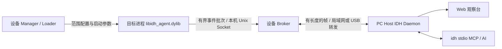

# 越狱版 v2 架构与实施设计

日期：2026-10-25。状态：设计已落盘，尚未实现 v2。代码基线：`c884831` / 1.27.5。

## 1. 产品决策与适用范围

- `main` 是已经基本定型的巨魔版：保留进程内 dylib + Web / MCP 的现有形态，以缺陷修复、兼容性和稳定性维护为主。
- `jailbreak` 是独立演进的越狱分析平台，允许重构 Agent、控制面和事件模型，不再要求与巨魔版保持同一份核心或相同运行行为。
- 两条产品线分别构建、验证、发版。真正共用的算法、解析器与修复按需移植，不为维持源码一致而限制越狱能力。
- 本文是越狱 v2 的唯一架构和实施路线。`ARCHITECTURE_BOUNDARY.md` 中旧的一份核心、进程内 HTTP / MCP、禁止 inline 的条款仅约束现有 v1 `src/` 兼容路径和巨魔版，不约束新 `agent/`。
- 本次交付设计与构建环境验证，不实现或宣称已有 Inline Hook、函数出口采集、指令 Trace。

目标工作流：选择目标进程 → 枚举模块/函数 → 安装 Hook → 操作目标 App → 读取真实命中时的参数/输出 → 关联网络与加密 → 对关键函数做受限追踪 → 导出可回查结果。

## 2. Android 项目中实际参考的内容

参考仓：`android-decrpthub`，现场提交 `6663ffe623621f1b07657d25d2e242e68ad77527`。
该工作区存在未跟踪的 `website/`，本次未修改 Android 仓库或操作其设备。

| Android 参考 | 越狱 iOS 采用方式 |
|---|---|
| `agent/src/MAP.md`、`daemon/src/MAP.md` | 目标进程采集 / PC 分析 / 设备接入管理分层 |
| `agent/src/hook/native_hooks.cpp` | 统一 Hook 注册表、真实安装状态、命中计数、调用前后内存窗口 |
| `agent/src/hook/native_event_budget.h` | 先过滤、抽样、预留额度，再复制内存与生成事件；计数区分未命中与未保留 |
| `agent/src/hook/native_inline.h`、`native_inline_dobby.cpp` | 后端适配层独立于 Hook 业务；安装结果必须包含可用 original 与真实错误 |
| `proto/PROTOCOL.md`、`agent/src/bootstrap/io.c` | 有长度的帧协议、命令 ID、分片和有界队列；采用当前代码的 length-framed，不沿用旧架构文档的 NDJSON 草图 |
| `daemon/src/trace_store.ts`、`crypto_evidence.ts` | Trace 数据存储、索引、摘要与证据核验放在 Host |
| `daemon/src/analysis_guide.ts`、`analysis_assist.ts` | AI 接入指南、当前事实、证据缺口与下一步建议，避免让 AI 猜地址和线程 |

不直接移植 Linux 的 procfs、perf 硬件观察点、Zygisk、JNI / ART 和 Android 汇编桥。Darwin 内存、Mach-O、ObjC / Swift ABI、PAC、越狱加载与签名分别实现和验证。

## 3. 目标架构



| 部件 | 应承担 | 不承担 |
|---|---|---|
| 目标进程 Agent | Hook、命中时快照、受控运行时操作、模块快照、受限 Trace、轻量 RPC | Web / HTTP / MCP、数据库、全量索引、常驻符号化与反汇编分析 |
| 设备 Broker | 多进程路由、会话登记、有界转发缓存、心跳、连接恢复 | 对目标数据做重分析或持有无界历史 |
| 设备 Manager / Loader | 应用选择、注入、启停、能力与健康展示、包装路径适配 | 分析、算法识别、Trace 存储 |
| PC Host（`idhd`，拟新增） | 会话、命令、存储、Mach-O / 反汇编、调用链、网络关联、HTTP / Web / MCP、分析指南 | 在目标线程执行代码 |
| Web | 观察、筛选、对照、可视化、导出 | 维护第二套工具业务实现 |

设备 Broker 和 PC Host 是两个明确不同的进程。设备端现有 updater daemon 是否合并启动管理，需在取得 `IOSDecryptHubJB` 源码后核对，不能再造一套相互竞争的服务。

Agent 通过 Loader 传入的配置连接本机 Unix Socket；越狱路径由设备适配层解析，Agent 不写死 `/var/jb` 或 RootHide 路径。Broker 拟使用独立设备端口 `8762`；Host 对外默认 `8088`、MCP 保留 `/api/mcp`。端口冲突明确报错并允许配置，不自动结束 Android Host 等现有服务。

USB 转发与局域网是连接方式，不改变会话和命令语义。具体转发工具与 CLI 参数在接入切片中实现并验收；本文的端口和 `idhd` 均属于目标设计，不是现有客户端已经支持的接口。

离线时 Agent 不阻塞宿主，保留有限窗口并统计丢失。第一阶段不要求设备端离线 Web 分析；需要独立浏览器使用时，Host 可运行在局域网常驻电脑上。

## 4. 代码与仓库边界

拟新增目录，当前并未创建对应实现：

```text
agent/
  include/idh_agent_api.h          版本化启动 / 命令 / 事件 ABI
  src/bootstrap/                  启动、单实例、会话代际、连接
  src/capture/                    有界事件、内存窗口、预算
  src/hook/                       注册表、目标解析、调用前后桥
  src/hook/backends/              fishhook / objc / ellekit 适配器
  src/runtime/                    Mach-O、ObjC、内存、模块加载
  src/trace/                      函数级追踪、可选 DBI
  src/transport/                  帧与命令通道
host/
  src/session/                    会话、进程代际、命令调度
  src/store/                      事件、blob、Trace、保留策略
  src/analysis/                   符号化、反汇编、关联、算法核验
  src/tools/                      单一工具注册表、指南与工作流
  src/transport/                  Broker 接入、REST、MCP
protocol/                         帧、事件和命令 schema / 兼容测试
fixtures/                         静态链接函数、ObjC、多线程测试宿主
tests/jailbreak/                   Host / 模拟器 / 真机分层验收
```

`src/` 先保留为 v1 兼容实现，迁移完成前不大面积搬文件。新 `agent/` 可在后端中使用 inline / 可执行内存，不受 v1 `src/` 禁令限制。Host 是独立组件，不能把当前 `mcp_server.m` 整体链接进新 Agent。

`IOSDecryptHubJB` 继续负责开源 Loader / Manager / Broker 包装，消费私有 Agent 成品和公开 ABI / schema；不把私有引擎源码复制到开源仓。若某个后端独立成扩展 dylib，其注册和事件出口仍必须经过 Agent 的统一接口，不直接写旧 `DHLogStore` 的 ObjC 内部对象。

## 5. Hook 管理与后端

### 5.1 统一 HookRegistry

所有内置加解密 Hook、动态导入 Hook、ObjC Hook、Inline Hook 均登记到同一注册表：

- 目标身份：`processGeneration + imageUUID + RVA`，ObjC 另含 Class / selector / instance-or-class。
- `hookId`、owner、mechanism、backend 及版本、original、安装前证据、启用状态、资源占用。
- 状态区分 `resolving / installed / installed-never-fired / active / disabled / failed / retired`。
- 计数至少包含 hits、filtered、sampledOut、budgetRejected、emitted、ringDropped、transportDropped。
- 多个本项目观察者复用同一次 patch；冲突返回现有 owner。检测到其它框架改写时报告现状，不能直接覆盖或恢复别人指令。

命中回调只做预算判断、有限寄存器/内存复制、入环和原函数转发。JSON、十六进制文本、完整符号化和网络发送在工作线程或 Host 完成。

### 5.2 Inline Hook 的范围与选型

第一切片解决：静态链接 C 函数、模块内直接调用、没有导入槽位的自研算法函数。寻址支持模块 UUID + RVA，或当前会话的绝对地址；镜像/进程代际变化后旧地址失效。

**首选验证 ElleKit 适配器**：现有越狱路线已使用其加载生态，上游明确提供 arm64 / arm64e 的 C Hook。它仍须通过本项目的 original 转发、并发命中、代码页、PAC 和设备矩阵测试，不能以“库存在”当作已支持。[ElleKit 上游](https://github.com/tealbathingsuit/ellekit)

**Dobby 作为比较候选**：Android 已采用它，上游列出 iOS / ARM64 支持；这不足以证明本项目的 arm64e 与 RootHide 环境可用。只有主选不能满足验收时，单独验证并显式选择后端，禁止失败后静默换机制。[Dobby 上游](https://github.com/jmpews/Dobby)

注册表公开 `softDisable / hardUnhook / enterCapture / leaveCapture / stackArgs / floatArgs / structReturn` 等实测能力。默认软停记录，桥和 original 保留到安全退休。硬卸载仅在后端支持、无在途调用、当前 patch 归属仍一致时开放；不承诺靠保存几字节即可安全卸载所有后端。

### 5.3 参数、输出与 ABI

- 首先提供调用前通用寄存器快照和显式 `ptr_arg + length_arg + max_bytes` 内存窗口。
- 出口采集是独立能力：需要真正的 call-through 桥、嵌套调用上下文与返回现场保存；不能在尾跳原函数的入口桥后“补一段逻辑”冒充调用后。
- 支持整数、指针、浮点、栈参数、间接结构体返回等必须分别声明与验收；ObjC 消息桥不能当成任意 Swift ABI 桥。
- 地址必须现场安全读取；非法地址记录 unreadable，原始长度与实际捕获长度分别保存。
- C++ 异常、ObjC 异常、longjmp、非返回函数和特殊 Swift 调用约定先明确限制；不支持的出口方案拒绝安装或仅提供入口观察，并在结果中说明。
- 任意改参、改返回值、主动调用、内存写回可作为后续显式命令加入；与只读观察分开，默认不启用。

## 6. Trace 分层

| 层级 | 首要交付 | 明确边界 |
|---|---|---|
| 函数入口观测 | 目标函数命中、调用者、TID、参数快照 | backtrace 是命中时的栈，不是完整执行轨迹 |
| 函数调用 Trace | 指定目标集合的 enter / leave、parentSpan、耗时与输出 | 只覆盖已布置的函数，不宣称整个进程完整调用图 |
| 指令 Trace | 显式函数/模块范围、指令/时间/记录预算、分页结果 | 独立可选 DBI，不承诺所有设备和线程可用 |

指令后端候选 QBDI。上游明确将 iOS 标为不稳定且需越狱，并列出信号、线程创建和 C++ 异常限制，因此它不阻塞基础 Hook 交付。[QBDI 上游说明](https://raw.githubusercontent.com/QBDI/QBDI/dev-next/README.rst)

区分 `live-entry`（真实命中现场执行）和 `replay`（人工重新调用）。后者可能有副作用，不能证明原始请求走过同一路径。局部寄存器不足以重建完整现场时必须标记 `contextComplete=false`，不能声称等价重放。

Trace 状态包含 traceId、session、processGeneration、覆盖范围、过滤、预算、丢失、停止原因和完成度。停止需协作退出；Host 的命令超时不代表目标线程已经被安全中止。Trace 活动期间禁止卸载相关 Hook / 模块。

Android 的 perf root_watch 不直接映射为 iOS 硬件观察点；后者涉及 Mach 调试权限、异常处理和越狱支持，另开研究切片，不混入首批承诺。

## 7. 统一事件与协议

### 7.1 事件信封

以下为拟定字段契约，不是现有 `DHLogEntry` 已支持的字段：

| 字段 | 含义 |
|---|---|
| schemaVersion / agentBuildId / protocolVersion | 结构、构建与通道版本 |
| sessionId / processGeneration / pid / tid | 事件来源；PID 重用不得混会话 |
| seq / monotonicNs / wallTimeMs | 进程内顺序、耗时基准、人类时间；跨设备单调时钟不能直接比较 |
| kind / mechanism / hookId | crypto / network / function / module / trace / diagnostic；fishhook / objc / inline / dbi |
| callId / parentCallId / phase | entry / leave 关联；parent 仅在已观察到的调用关系中建立 |
| imageUUID / rva / pc / lr | 运行地址与可持久化定位身份 |
| payload | 各类型结构化字段，不通过 detail 文本反解析协议 |
| blobs | 原始长度、实际长度、截断/不可读状态、内容引用 |
| observation | 抽样、额度、丢失与覆盖上下文 |

保留 v1→v2 适配器用于迁移既有 crypto / network 事件，不把 v2 新字段偷偷塞入 v1 文本。网络与加密按时间/线程/数据关联仅产生候选，Host 通过明确的字节或算法核验提升为已验证结论。

### 7.2 传输与会话

- 使用带长度与类型的帧：`hello / capabilities / command / result / eventBatch / blobChunk / heartbeat / gap`。
- hello 包含协议版本、Agent 构建身份、bundle、PID、进程启动身份、每次进程启动的随机 generation、架构、实际 ops / limits / backends。
- 网络重连保留同一进程 generation；进程重启生成新 generation。旧命令、旧 Hook ID 和旧地址禁止跨 generation 使用。
- 命令含 commandId、sessionId、generation 和截止时间；超时、取消请求、实际完成分别记录。安装/卸载等变更以 commandId 做有界幂等，重连不盲目重放。
- 控制与事件具有独立额度，Trace 洪水不能饿死 stop / health。流量满时丢事件并发 gap，不能阻塞命中线程。
- 地址、寄存器、seq 等大整数在线协议中使用十六进制或十进制字符串，避免 JavaScript 的数值精度丢失。

### 7.3 初始资源预算

下列是首个验收切片的待测默认值，不代表当前性能承诺：

| 资源 | 初值 |
|---|---|
| 通用 Hook 数 | 每进程最多 128；槽位耗尽与退休槽位分别可见 |
| 单次通用内存窗口 | 最多 4 个，每个 256 B，总计不超过 1 KiB |
| 事件环 | 每进程 4 MiB 字节上限，同时限制记录数 |
| 堆栈 | 最多 32 帧，默认保存地址，Host 符号化 |
| 事件批 | 最多 64 KiB；控制帧最多 256 KiB；blob 独立分片 |
| 函数 Trace | 显式目标与 TID/模块过滤；默认关闭 |
| 指令 Trace | 起始建议 10,000 指令、100 ms 协作时间预算、1 MiB 输出上限 |

持续 crypto 流还需每上下文字节数、上下文总数和过期回收；仅限制每条落盘大小不能控制命中线程的内存复制。所有预算在复制之前生效，完整率不能因丢记录而继续显示 100%。

## 8. 工具与控制面

拟定能力域：session / capabilities、module / symbol / memory、capture、hook、trace、event / artifact、analysis / guide。

每个工具只注册一次：名称、输入 schema、handler、所需能力、只读/变更属性、超时与资源上限同条登记，由它生成 MCP 和 REST 适配。设备能力取运行中 Agent / Broker 的实际回复，不用分支名或文档推断。

Hook 工具至少提供 install / status / disable，结果返回 resolvedTarget、mechanism、backend、actualPatch、originalAvailable、hitVerdict、limits、failureStage。零命中需要区分未安装、已安装未执行、被过滤与有命中但未保留。

Trace 提供 start / status / stop / read，数据分页并与 traceId / generation 绑定。Host 负责保存、摘要、寄存器与内存变化查询，MCP 默认返回摘要和引用，按需读取原始字节。

分析指南直接可通过 MCP 查询，描述当前支持的观察路径、限制与下一步所需现场数据；不为了给建议而自动安装 Hook、触发目标函数或重新发送请求。

## 9. 分阶段实施与退出条件

| 阶段 | 交付切片 | 必须通过的验收 |
|---|---|---|
| P0 接入骨架 | Agent 启动 ABI、Broker、Host、帧协议、会话/能力、确定性 fixture | 两目标进程隔离；断连重连；PID 重用不串会话；畸形/超长帧拒绝；Host 停机不阻塞 fixture |
| P1 Inline 入口闭环 | 统一 HookRegistry、首选后端、地址/UUID+RVA、original、入口参数和内存窗口、软停 | 静态链接 noinline 函数的同模块直接调用被捕获；原返回值正确；多线程/重入、非法指针、零命中、重复安装、停记录后原函数继续工作 |
| P2 出口与现有能力迁移 | enter / leave、返回值/输出内存、crypto / network / file / Keychain 迁移 | 输出缓冲区、整数/浮点/结构体/栈参数和递归分别测；旧能力在新通路可查；有界长流与丢失计数；未支持 ABI 明确拒绝 |
| P3 函数 Trace | callId / parent、指定集合、耗时、调用链、Host 存储与查询 | 跨线程不乱配；递归配对；异常/退出不伪造 leave；停止可确认；输出覆盖边界 |
| P4 指令 Trace | QBDI 或经过验证的其它独立后端、分页/摘要、live vs replay 标记 | 分支/内存访问固定 fixture；预算和协作停止；不支持设备如实报告；真实命中与重放验证分开 |
| P5 高级运行时工具 | 按需要增加 ObjC 对象观察、受控调用/写入与恢复、模块加载时布防、算法核验 | 每个工具有确定性 fixture 与失败路径；任何新技术后端独立验收 |

P1 是最早有实际新增逆向价值的交付点；P0 保持最小范围，Host 先完成接入、drain、查询和 MCP，不等复杂工作台做完再验证 Hook。每个切片独立提交、构建与回滚，不先一次性改完所有层。

## 10. 迁移与发布

1. v1 继续作为明确选择的 legacy 模式。v2 以测试包 / fixture 开始，保持唯一引擎所有者；同一目标不能同时注入 v1/v2 或装两套默认 Hook。
2. 先建立新 Agent / Host 的窄闭环和 P1，再逐族迁移采集能力。迁移期间不删除旧路径，切换模式必须显示实际模式，不静默兜底为 v1。
3. v2 完成回归后，越狱正式包依赖匹配的 Agent / Broker / Loader。发布 manifest 含各组件版本、协议、架构、最低系统、签名结果和 SHA-256。
4. Host、Agent、Broker 的不兼容协议拒绝建立可变更会话；可读历史事件由 schema 迁移处理，不能把版本冲突当空数据。
5. 普通 arm64、arm64e / PAC、rootless、RootHide 分别记录构建/安装/运行状态。macOS 或模拟器通过不等于真机 Inline / PAC 已通过。
6. `main` 不整分支合入；需要的公共修复评估后单独移植。本设计不升 Makefile 版本、不打功能发布标签。

## 11. 验证环境与当前事实

2026-10-25 已通过用户确认的 Mac 完成 SSH 登录，实测工具链为 macOS 15.6.1 / Apple Silicon、Xcode 26.3、iPhoneOS / Simulator SDK 26.2；Homebrew 下有 ldid / CMake，存在 Theos。

已在独立临时目录从 `c884831` 归档编译：

- `make VARIANT=trollstore`：生成 arm64 Mach-O dylib。
- `make -B VARIANT=rootless ARCHS="arm64 arm64e" all`：生成 arm64 + arm64e 通用 Mach-O dylib。

这证明现有源码可以经 SSH 在该 Mac 编译，不证明新 Inline 后端或 Trace 已实现，也不证明 deb / IPA 的完整打包、签名和设备安装已验证。Mac 构建目录不覆盖其现有工程；SSH 地址、用户名和密钥配置只保存在本机项目记忆，不写入仓库。

验证分层：Host 单元/协议测试 → Mac 编译与解析 fixture → Simulator 采集 fixture → arm64 越狱真机 → arm64e / RootHide 真机。最后两层必须使用明确授权的测试设备；本次不操作任何手机。

## 12. 已做与待做

- 已做：Android 当前架构/原语核对、巨魔定型与越狱独立演进的设计、Mac SSH 与现有双变体编译验证。
- 待做：取得并核对 `IOSDecryptHubJB` 当前源码；P0 接入组件；首选 Inline 后端的 iOS fixture 实测；明确两类越狱测试设备。
- 未做：v2 运行时实现、Inline Hook 安装、Trace、手机安装、正式包发布。
