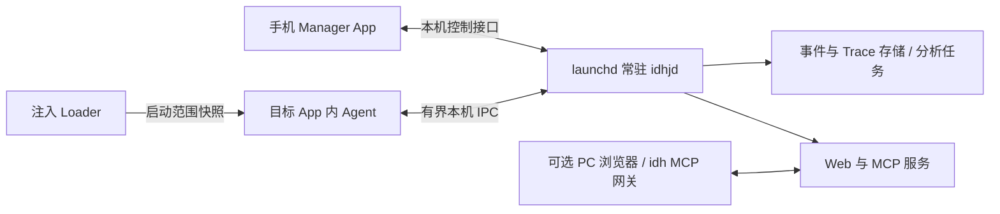

# IOSDecryptHubJB：独立项目、手机常驻服务与整包交付

日期：2026-10-25。状态：架构与产品交付设计，尚未实现新版守护程序 / Manager / 整包构建。

## 1. 最终产品边界

- `IOSDecryptHub`：巨魔版独立项目，能力基本定型，维护现有注入和 Web / MCP 形态。
- `IOSDecryptHubJB`：越狱版独立项目，本仓库；使用自己的 `main`、版本、构建、测试和发布。
- 不再通过巨魔仓的 `jailbreak` 分支开发产品，也不再要求从巨魔仓先编译 dylib、复制进越狱仓后打包。
- 越狱用户安装 **一个 deb 整包**，包含常驻服务、手机管理 App、注入加载器、采集 Agent、Web 资源和包维护脚本。rootless / RootHide 各生成适配本环境的一份整包，不是拆成用户需要手工拼装的多个组件。
- dylib 仍是注入到目标进程所需的内部二进制，由整包任务自动编译、签名、校验并装入 deb，不单独作为用户的下载、构建或更新步骤。
- 通过独立的 APT 越狱源交给 Sileo / Zebra 等包管理器统一升级。Manager / daemon / loader / agent 必须同一批次发布，禁止各组件自行下载覆盖。

本项目最初从个人引擎仓拆出，随后于 2026-10-26 按组织正式 `a94a396` 校正基线并纳入其历史，恢复完整 v1 Manager、Loader、一次性 updater 与整包构建。见 [基线核验](./BASELINE_AUDIT_2026-10-26.md)。现有 v1 组件可构建不代表 v2 常驻分析服务、UI 改造或 Inline / Trace 已完成。

**公开源码补充核对**：组织既有 [IOSDecryptHub](https://github.com/decrypthub/IOSDecryptHub) 的 `main` 已包含 `app/` 管理器、`src/loader.m`、一次性 updater daemon、`build_deb.sh` 和发布 workflow，并有 v1.27.5 dylib / 两类 deb Release。新仓已将其登记为本机只读参考 `legacy-public/main`（核对提交 `a94a396`）。这些是要迁移的实际 v1 功能，区别于本设计新增的常驻分析服务与整包源更新；不能因为前期未检索到本地并列仓就从零重复实现。旧公开仓不覆盖、不重命名，以保留现有下载和更新地址。

## 2. 手机独立运行，PC 可选



**手机 daemon 是控制与数据中心，PC 不再是必需依赖。** 新方案替代之前“设备只做 Broker、分析必须在 PC Host”的设计。

| 部件 | 职责 |
|---|---|
| `idhjd` | 常驻、应用目录、scope 配置、进程/Agent 会话、命令路由、事件存储、受限分析、HTTP / MCP、健康与版本 |
| Manager App | 状态、应用注入开关、逐应用能力配置、目标进程操作、服务连接与源更新入口 |
| Loader | 读取有版本的 scope 快照，判断当前进程是否允许注入，按配置加载 Agent；保持薄层 |
| Agent dylib | fishhook / ObjC / Inline 后端、命中快照、有界事件、受限 Trace、原函数转发 |
| 可选 PC 客户端 | 浏览器观察、stdio MCP 转接、导出或离线重分析；不承担手机注入开关的状态真相 |

Agent 命中线程不执行磁盘写入、JSON 编码、完整符号化或网络发送。Daemon 在目标进程之外承担这些工作，重分析使用低优先级队列、分页和字节/时间限额，不能因为获得 root 就无限占用手机资源。

实现优先使用 C / C++ / Objective-C 与系统库，Manager 使用 SwiftUI；不要求在手机安装 Node。模块职责与 Android 对齐，平台 IPC、签名和后台管理采用 Darwin 实现。

## 3. 常驻与生命周期

- launchd 启动服务并配置 `RunAtLoad`、适当的 `KeepAlive` 与重启节流；daemon 不自行 fork 到后台。参考 [Apple launchd 文档](https://developer.apple.com/library/archive/documentation/MacOSX/Conceptual/BPSystemStartup/Chapters/CreatingLaunchdJobs.html)。
- **常驻的是 daemon**。Manager 退到后台或被划掉，不终止采集服务；目标 App 按自己的生命周期运行，不为采集强行保持存活。
- 越狱引导可用时启动，异常退出后恢复；重启设备后须等待相应越狱环境恢复，不能承诺越狱失效时仍常驻。
- daemon 重启恢复 scope、限额与历史，在线 Agent 用新连接恢复登记；进程 generation 与连接 generation 分离，旧命令不能路由到重用 PID 的新进程。
- daemon 离线时 Loader 仍能读取最后一份有效 scope；Agent 只保留有限窗口并计数丢失，不阻塞宿主，也不在命中线程等待服务启动。
- 恢复异常必须显示具体失败阶段。不能把服务不可达显示成“应用未启用”，也不能用无界崩溃重启循环掩盖失败。

## 4. 手机应用注入开关

### 4.1 状态真相

daemon 唯一负责写 scope，并按版本化 schema 验证、迁移、原子替换快照。Manager 发起有限业务请求，不直接写 root 文件或执行任意 shell。Loader 只读快照，启动路径不等待同步 daemon RPC。

scope 至少含 `schemaVersion / revision / globalEnabled / apps[bundleId].enabled / families / includeExtensions`。每次写入携带期望 revision，冲突返回新快照，避免两个 UI 请求互相覆盖。

应用行必须分开显示：

- 期望：启用 / 关闭。
- 保存：已持久化 / 保存失败。
- 运行：未运行 / 待重启生效 / 已注入 / 已停止记录但仍驻留 / Agent 失联 / 加载失败。

开关返回成功只表示配置已保存；只有目标进程登记了匹配的 Agent / scope revision 才能显示“已注入”。UI 重新进入前台时从 daemon 拉取快照，不以本地缓存代替实际状态。

### 4.2 开关语义

| 操作 | 立即效果 | 完全生效条件 |
|---|---|---|
| 开启某应用 | scope 保存为启用，标记待启动/重启 | 目标下一次启动由 Loader 注入，收到 Agent 登记 |
| 关闭某应用 | 后续启动不再注入；若 Agent 在线，先停止新采集/新任务并报告结果 | 当前已加载 dylib 完全离开需目标退出/重启，不能假称卸载成功 |
| 关闭全局 | 保留逐应用选择，禁止后续注入，并通知在线 Agent 停止新采集 | 旧进程完全退出后无本项目 Agent |
| 修改能力族 | 持久化逐应用策略，并协商在线引擎能否即时启停 | 不支持热变更的项明确显示待重启 |

开关不自动杀进程。应用详情提供“停止应用”“重新启动并应用配置”，作为用户显式操作；目标重启还需核对应用归属和进程 generation，不能仅凭名称或旧 PID 操作。

默认应用清单为空；默认排除 Manager、daemon、系统关键进程。App 扩展以独立 bundle / process 记录，默认不随主 App 自动启用，UI 需明确其范围。

### 4.3 应用目录

daemon 枚举已安装应用与目标进程，返回名字、bundle ID、版本、图标引用和可用状态；图标按可见行懒加载，列表分页。应用被卸载/重装、bundle 路径变化后重新校验，不沿用旧路径作为注入依据。

## 5. 手机 UI 参考 Android 的方式

参考现有 Android `device/:manager` 的状态优先首页、应用 scope 列表、逐应用 Hook 配置、前台刷新与进程启停。采用 iOS 原生控件，不复制 Compose 实现。

三项底栏：**首页 / 应用 / 设置**。

- 首页：daemon 状态、整包/运行中引擎版本、环境、已启用应用和在线进程、Web / MCP 地址、更新状态。
- 应用：搜索、已启用/全部筛选、应用图标/名称/bundle ID、注入开关、真实生效状态；点击进入逐应用配置。
- 设置：全局开关、采集/存储限额、服务与连接、越狱源和更新入口、诊断、关于。
- 应用详情：基础采集族、Inline / Trace 当前可用状态、进程列表、启停、诊断和查看记录入口。

不照搬 Android 的证书页、ART/JNI、Zygisk 或其它本项目未实现的能力。详细页面状态与交互见 [Manager UI 规格](./MANAGER_UI.md)。

## 6. 统一整包构建与 APT 更新

目标构建入口是一次任务生成匹配环境的完整 deb：Manager → daemon → loader → agent → 签名/依赖校验 → deb → 包内与索引验证。不能依赖开发者预先手工提供一份 dylib，也不能通过缺失组件时“仅打引擎”来报告整包成功。

| 包内组件 | 用途 |
|---|---|
| Manager `.app` | 手机管理界面 |
| `idhjd` 可执行文件与 LaunchDaemon plist | 常驻服务 |
| Loader dylib 与注入规则 | 按 scope 加载 Agent |
| Agent 与明确需要的后端/资源 | 采集和运行时执行 |
| Web 资源、schema、包维护脚本 | 手机服务、兼容与升级 |

rootless / RootHide 使用各自工具链、包架构和路径解析；不能只改 deb 文件名或 Architecture 就当作适配。Theos rootless 的前缀与 `@rpath` 处理见 [官方文档](https://theos.dev/docs/rootless)。

一处版本真相生成 package Version、App 版本、各二进制版本和协议 manifest；运行中的旧 Agent 版本与磁盘新包版本分别显示，更新后必须提示受影响目标待重启。

APT 发布要求：

1. 使用本产品唯一规范源地址（正式域名尚未配置，不臆造、不复用其它产品源）。
2. 生成 deb、`Packages` / `Packages.gz`、`Release` 与校验信息；签名按正式源和客户端支持配置。
3. 先上传并校验 deb，再发布引用它们的索引，保留旧包和明确的回退版本。
4. Manager 可检查并展示包管理器候选更新，引导打开 Sileo / Zebra 完成交易；不从宿主 App 下载/覆盖 dylib，不让 daemon 私下并发执行另一套升级器。
5. 安装/升级脚本幂等，迁移 scope 和存储 schema，校验后恢复服务；remove 与 purge 的数据保留语义不同。失败须返回真实状态，不能承诺 dpkg 会自动回滚全部副作用。参考 [Debian 包维护脚本规则](https://www.debian.org/doc/debian-policy/ch-maintainerscripts.html)。
6. 更新服务不自动结束用户目标 App；旧引擎继续已支持的会话或停止采集并提示版本不匹配，不把磁盘新版本当成旧进程已更新。

## 7. Hook / Trace 与服务协议

统一 HookRegistry、Inline 后端、调用前后 ABI、事件预算、函数与指令 Trace 继续按 [Hook 与 Trace 设计](./HOOK_AND_TRACE_DESIGN.md) 逐阶段完成。

Agent ⇄ daemon 使用有长度的本机 IPC 帧与独立控制/事件额度；命令绑定 sessionId、processGeneration、commandId 和截止时间。Daemon ⇄ Manager 使用版本化的有限控制接口；同一工具的手机 UI、REST、MCP 入口共享服务实现，不各写一份逻辑。

Web / MCP 对外保持设备 `8088` 与 `/api/mcp` 的产品习惯，stdio 网关可继续使用。多 App 共享一个设备服务端口，按 session 路由；旧 v1 进程内服务迁移时明确冲突和模式，不能悄悄换端口后让用户猜。

手机存储、反汇编和关联分析在 daemon 的工作队列运行，任务可分页、取消、限额和查状态；指令 DBI 仍在目标 Agent 按需执行。PC 离线不会影响 scope、注入和基本采集；需要大量离线分析时再导出到 PC。

## 8. 工程结构与迁移

目标目录与已有组件的迁移方向（现有 `app/` 为正式 UIKit Manager，现有 `daemon/` 为一次性 updater；未实现部分不建立空壳冒充交付）：

```text
manager/       手机 SwiftUI App
daemon/        idhjd：scope、会话、事件、任务、HTTP/MCP
loader/        进程筛选与注入入口
agent/         Hook、运行时、Trace、有界采集
shared/        scope / IPC / 事件 schema 与生成代码
packaging/     rootless / RootHide 布局、维护脚本、依赖
repository/    APT 索引和候选发布校验
fixtures/      确定性 iOS 测试宿主
tests/         契约、构建、包内与真机验收
src/           暂留的 v1 引擎迁移基线
```

本项目自己编译引擎，自己打 deb；不再将引擎跨仓复制到另一个 `IOSDecryptHubJB/vendor`。旧 `app-trollstore/` 和旧跨仓脚本仅为导入历史，不能作为新版 Manager 或正式构建入口。

巨魔仓历史 `jailbreak` 分支只保留追溯，不删除；未来产品开发、版本标签和 CI 全在各自仓库 `main`。适用公共修复明确移植，不要求跨产品同步整个目录。

## 9. 实施顺序与验收

| 阶段 | 交付 | 退出条件 |
|---|---|---|
| J0 基础整包 | daemon + 最小 Manager + Loader + 现有 Agent 的单 deb 接入 | 一次构建出完整 deb；安装后 UI 能看到 daemon；Manager 退出服务仍可用；卸载无启动残留 |
| J1 应用管理 | 应用目录、逐应用/全局 scope、状态、目标启停 | 启用 A 不注入 B；关闭后新进程不加载；旧进程状态真实；重启 daemon 和设备后配置保留 |
| J2 源更新闭环 | 统一版本、APT 索引、升级/移除脚本、UI 更新入口 | 从候选源升级完整包；配置保留；磁盘与运行版本区分；旧客户端/Agent 不兼容时明确报错 |
| J3 Inline 闭环 | 统一注册表、选定后端、入口参数与内存窗口 | 静态链接同模块调用命中、original 正确、多线程/非法地址/软停可验证 |
| J4 出口与函数 Trace | 输出快照、enter/leave、调用关联、迁移既有采集族 | ABI 各类 fixture、递归与线程不串配、限额与丢失计数真实 |
| J5 指令与高级分析 | 可选 DBI、分页 Trace、算法核验与其它原语 | 真机矩阵分别记录；范围/完成度可查；不支持后端不影响基础能力 |

J0/J1 优先解决“安装整包、打开应用开关就能采集”的手机闭环；不先堆新 Hook 但让用户手动搬 dylib。

## 10. 当前事实

- 已建立独立项目并校正到正式 a94a396 的完整 v1 基线，恢复 app/、daemon/、Loader 与 make deb；已核对 Android 的 Manager / scope / daemon 结构。
- 已在 Mac 经 SSH 验证完整 make deb，rootless / RootHide 包内组件、架构、依赖与布局检查通过；测试包未发布、未安装手机。
- 本工作树尚未完成新常驻 daemon、Manager 改造、scope IPC、整包迁移与 Inline / Trace；现有公开 v1 已有管理器、一次性 updater、整包与源说明，必须区分新旧状态。本次未安装手机、未发布 deb、未部署源。
- 已知旧公开 README 声明源 `https://ios.decrypthub.com`、包 ID `com.iosdecrypthub`。新包需先核对线上索引、签名与存量安装再设计接管；本轮未改变旧源或更新服务。
